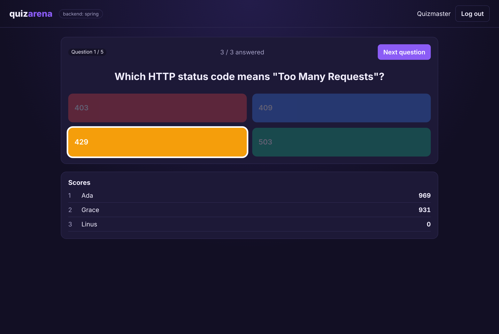
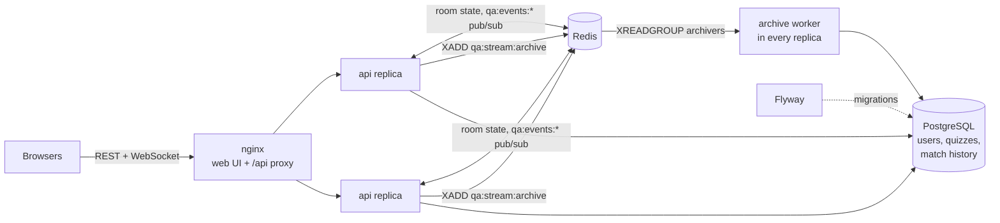

# quizarena

A live multiplayer quiz game: a host opens a room, players join with a six-letter code, and everyone races the clock while scores update in real time.

The same API and WebSocket protocol are implemented three times, in **Spring Boot**, **Node.js/Express** and **ASP.NET Core**, on one shared PostgreSQL schema and one set of Redis keys. They're interchangeable to the point that one game can be served by a mix of backends at once.


## Contents

- [Introduction](#introduction)
- [Interface](#interface)
- [Architecture](#architecture)
- [Modular backend](#modular-backend)
- [Usage](#usage)
  - [Quick start](#quick-start)
  - [Self-hosting guide](#self-hosting-guide)
  - [Configuration](#configuration)
  - [Running a backend from source](#running-a-backend-from-source)
- [Testing](#testing)
- [Project layout](#project-layout)

## Introduction

Real-time games are a good test of backend design: state changes many times a second, every player has to see the same thing, and the server, not the client, has to decide who was fastest. quizarena covers the whole loop:

1. **Build.** Players write quizzes (2 to 4 options per question, 5 to 120 seconds each). Only the owner or an admin can read the answers or delete a quiz.
2. **Play.** The host opens a room. The live game state lives in Redis, so any API instance can serve any room. Commands go over REST, and every change is pushed to all sockets through Redis pub/sub.
3. **Score.** Answers are timed on the server from the moment the question opened: 500 points for a correct answer plus up to 500 more for speed. One answer per player per question, enforced atomically.
4. **Archive.** When a game ends, a job goes onto a Redis stream. A consumer-group worker writes the results to PostgreSQL, which feeds match history and a cached all-time leaderboard.

What it shows:

| Concern | How |
| --- | --- |
| Real-time | WebSockets with a snapshot on connect, then a push after every change |
| Horizontal scaling | Stateless instances; Redis pub/sub fan-out so players on different replicas see the same game |
| Fairness and anti-cheat | Server-side timing and deadlines, `HSETNX` for one answer each, answers hidden until the reveal |
| Background jobs | Redis Streams consumer group with acknowledgements and retry of unacknowledged jobs; idempotent inserts |
| Auth | Stateless JWT (HS256) with `player` and `admin` roles, plus resource ownership checks (owner or admin) |
| Caching and limits | Cache-aside leaderboard (`X-Cache: HIT/MISS`), per-user rate limit on hosting rooms with `Retry-After` |
| Data | PostgreSQL arrays and `CHECK` constraints for question shape, transactional quiz creation, Flyway migrations |
| API design | OpenAPI 3 contract, RFC 7807 problem responses with machine-readable codes |
| Operations | Docker Compose, nginx WebSocket proxying across replicas, GitHub Actions |

## Interface



The web UI (plain HTML and JavaScript, served by nginx) has a lobby with quizzes to host, a join-by-code box, a quiz builder, your match history and the leaderboard. In a room the host sees the code, the players and the controls; players get four big answer tiles and a countdown. The header shows which backend is answering.

The REST API is in [`contract/openapi.yaml`](contract/openapi.yaml) (paste it into [editor.swagger.io](https://editor.swagger.io) to browse it):

| Method | Path | Notes |
| --- | --- | --- |
| `POST` | `/api/auth/register`, `/api/auth/login` | Returns `{ token, user }` |
| `GET` | `/api/me`, `/api/me/matches` | Profile and finished games |
| `GET` / `POST` | `/api/quizzes` | List all, or create one you own |
| `GET` / `DELETE` | `/api/quizzes/{id}` | Owner or admin only |
| `POST` | `/api/rooms` | Host a room (rate limited) |
| `GET` | `/api/rooms/{code}` | Current state |
| `POST` | `/api/rooms/{code}/join`, `/start`, `/next`, `/answer` | Game commands |
| `GET` | `/api/leaderboard` | Public, cached |
| WS | `/api/rooms/{code}/ws?token=…` | `{"type":"room.updated","room":{…}}` on connect and after every change |

The game moves through `lobby → question → reveal → question → … → finished`, and the host's `next` drives it. Errors look like this everywhere:

```json
{ "type": "about:blank", "title": "You already answered this question", "status": 409, "code": "ALREADY_ANSWERED" }
```

## Architecture



**Live state in Redis** (identical in every backend):

| Key | Type | Holds |
| --- | --- | --- |
| `qa:room:{code}` | hash | match id, quiz snapshot, host, state, question index, when the question opened |
| `qa:room:{code}:players` | hash | user id → display name |
| `qa:room:{code}:scores` | sorted set | user id → score |
| `qa:room:{code}:answers:{i}` | hash | user id → option (`HSETNX` makes it one answer each) |
| `qa:events:{code}` | pub/sub | the new room view after every change |
| `qa:stream:archive` | stream | finished games for the `archivers` group |

Room keys expire after `ROOM_TTL_SEC` (6 hours by default), so abandoned games clean themselves up.

**Answering a question:** load the room → check the caller is a player → check the question is open and the server-side deadline hasn't passed → `HSETNX` the answer → if it's correct, `ZINCRBY` the score with the speed bonus → publish the new view. The response only says `accepted`; correctness shows up at the reveal, so a client can't probe for the right answer.

**Schema** ([`db/migrations`](db/migrations)): `users`, `quizzes`, `questions` (with `text[]` options and a check that the correct index points at one), `matches`, `match_players`. A starter quiz, "Backend Trivia", comes with the first migration.

## Modular backend

Three interchangeable implementations of the same contract:

| | Spring Boot | Express | ASP.NET Core |
| --- | --- | --- | --- |
| Folder | [`backends/spring`](backends/spring) | [`backends/express`](backends/express) | [`backends/dotnet`](backends/dotnet) |
| Language | Java 21 | TypeScript (Node 22) | C# 12 (.NET 8) |
| HTTP | Spring MVC | Express 4 | Minimal APIs |
| WebSockets | Spring WebSocket handler | `ws` | `UseWebSockets` |
| Pub/sub | `RedisMessageListenerContainer` | ioredis `psubscribe` | StackExchange.Redis pattern subscription |
| Streams worker | `@Scheduled` + `StreamOperations` | async loop + `XREADGROUP` | `BackgroundService` + `StreamReadGroupAsync` |
| Data access | `JdbcClient` | `pg` | Npgsql + Dapper |
| Auth | Spring Security OAuth2 resource server | `jsonwebtoken` | JwtBearer |
| Unit tests | JUnit 5 + AssertJ | Vitest | xUnit |

What makes them interchangeable:

- **One schema**, migrated once by Flyway before any backend starts.
- **One contract**: [`contract/openapi.yaml`](contract/openapi.yaml) covers paths, payloads, status codes, error codes and the WebSocket message.
- **Shared runtime conventions**: the Redis keys above, the same JSON for the quiz snapshot stored in a room, the same JWT claims (`sub`, `email`, `name`, `role`, `iss=quizarena`), and the same scoring and ranking functions. Each backend's unit tests pin the same values.
- **One test suite**: [`tests/contract`](tests/contract) talks only HTTP and WebSocket, and CI runs it against every backend with three replicas behind nginx.

Because the state and the event channel are shared, you can start a room on the Spring backend, have players join through Express, and watch it all on a socket held by ASP.NET.

```bash
BACKEND=dotnet docker compose up --build
```

## Usage

### Quick start

You need Docker with Compose v2.

```bash
git clone https://github.com/Khalil002/quizarena.git
cd quizarena
docker compose up --build
```

Open <http://localhost:8080>. Log in as the demo host (`admin@quizarena.local` / `admin1234`) and click **Host** on "Backend Trivia". In a private window, register a player and join with the code on screen. The default backend is Spring Boot.

### Self-hosting guide

1. **Install Docker.** Docker Desktop on macOS or Windows, or Docker Engine plus the Compose plugin on Linux. Check with `docker compose version`.
2. **Get the code.** `git clone https://github.com/Khalil002/quizarena.git && cd quizarena`
3. **Configure.** `cp .env.example .env`, then edit `.env`:
   - `BACKEND`: `spring`, `express` or `dotnet`.
   - `JWT_SECRET`: set a long random value, for example from `openssl rand -hex 32`. It must be at least 32 characters.
   - `DB_PASSWORD`: change it from the default.
   - `WEB_PORT`: the port the site listens on (default 8080).
4. **Start it.** `docker compose up -d --build`. The first build downloads dependencies and takes a few minutes.
5. **Check it.** `curl http://localhost:8080/api/health` should return `{"status":"ok","backend":"..."}`.
6. **Replace the demo admin.** Register your own account, then promote it and remove the demo one:
   ```bash
   docker compose exec postgres psql -U quizarena -c "UPDATE users SET role = 'admin' WHERE email = 'you@example.com';"
   docker compose exec postgres psql -U quizarena -c "UPDATE quizzes SET owner_id = (SELECT id FROM users WHERE email = 'you@example.com') WHERE owner_id = '00000000-0000-0000-0000-00000000a001';"
   docker compose exec postgres psql -U quizarena -c "DELETE FROM users WHERE email = 'admin@quizarena.local';"
   ```
   The middle command keeps the starter quiz by moving it to your account. If the demo admin has already hosted games, keep the account and just change its role to `player` instead of deleting it.
7. **Expose it (optional).** Put a TLS-terminating reverse proxy such as Caddy or Traefik in front of port 8080. It must pass WebSocket upgrades through (Caddy and Traefik do by default). The UI switches to `wss://` automatically when served over HTTPS.
8. **Operate it.**
   - Logs: `docker compose logs -f api`
   - Scale out: `docker compose up -d --scale api=3`
   - Switch backend: change `BACKEND` in `.env`, then `docker compose up -d --build api`
   - Back up: `docker compose exec postgres pg_dump -U quizarena quizarena > backup.sql`
   - Stop: `docker compose down` (add `-v` to delete the data too)

### Configuration

| Variable | Default | Meaning |
| --- | --- | --- |
| `BACKEND` | `spring` | Which implementation to build and run |
| `WEB_PORT` | `8080` | Host port for the UI, API and WebSockets |
| `JWT_SECRET` | dev value | HS256 signing secret shared by every replica |
| `ROOM_TTL_SEC` | `21600` | How long an idle room's Redis keys live |
| `RATE_LIMIT_MAX` / `RATE_LIMIT_WINDOW_SEC` | `10` / `60` | Rooms one user may host per window |
| `CACHE_TTL_SEC` | `5` | Lifetime of the cached leaderboard |

### Running a backend from source

Start only the infrastructure, with its ports on localhost:

```bash
docker compose -f docker-compose.yml -f docker-compose.dev.yml up -d postgres redis migrate
```

Then run one backend on port 8000:

```bash
cd backends/express && npm install && npm run dev            # Node 22
cd backends/spring && mvn spring-boot:run                      # Java 21
cd backends/dotnet && dotnet run --project src/Quizarena.Api   # .NET 8
```

## Testing

| Suite | Command | What it covers |
| --- | --- | --- |
| Contract (all backends) | `cd tests/contract && npm install && API_URL=http://localhost:8080/api npm test` | 17 black-box tests: auth, quiz validation, owner/admin authorization, lobby rules, a full two-player game with server-side scoring, deadlines, duplicate answers, archiving to match history, the leaderboard cache, rate limiting, and WebSocket snapshots, live updates and close codes |
| Express unit | `cd backends/express && npm test` | Scoring, room codes, ordering and ranking, schemas |
| Spring unit | `cd backends/spring && mvn test` | The same rules, plus Postgres array encoding |
| ASP.NET unit | `cd backends/dotnet && dotnet test` | The same rules, plus quiz validation |

CI ([`.github/workflows/ci.yml`](.github/workflows/ci.yml)) runs the unit tests, then starts the full stack with three API replicas for each backend and runs the contract suite through nginx.

## Project layout

```
contract/openapi.yaml        the API every backend implements
db/migrations/               Flyway SQL, shared by all backends
backends/spring|express|dotnet
tests/contract/              black-box suite (Vitest, fetch, WebSocket)
web/                         static UI
deploy/nginx.conf            UI hosting, /api and WebSocket proxying
docker-compose.yml           the whole stack
docker-compose.dev.yml       exposes infra ports for local development
```
